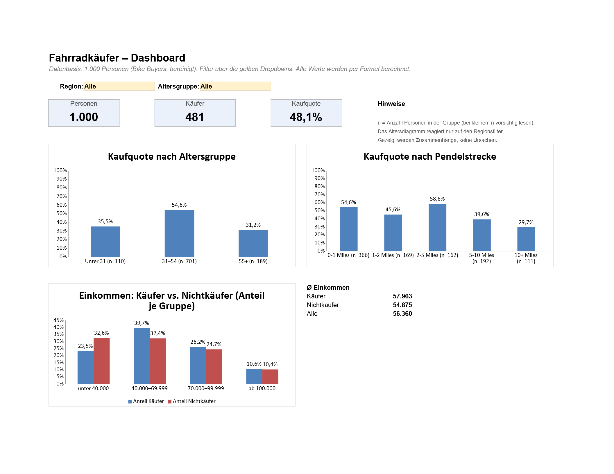

# Excel-Analyse: Wer kauft ein Fahrrad?

Kleine Excel-Analyse zu 1.000 Personen und der Frage, ob sie ein Fahrrad gekauft haben. Es geht um Käufermerkmale (Alter, Pendelstrecke, Einkommen, Region), **nicht** um Umsätze. Preise oder Stückzahlen gibt es im Datensatz nicht.

*Vorschau mit LibreOffice gerendert. In Excel sehen Schrift und Farben etwas anders aus.*

## Fragestellung

1. Wie unterscheidet sich die Kaufquote nach Altersgruppe?
2. Welcher Zusammenhang besteht zwischen Pendelstrecke und Fahrradkauf?
3. Wie unterscheiden sich Käufer und Nichtkäufer beim Einkommen?

## Daten und Herkunft

- Datensatz „Bike Buyers 1000“: [kaggle.com/datasets/heeraldedhia/bike-buyers](https://www.kaggle.com/datasets/heeraldedhia/bike-buyers)
- Die Rohdaten in dieser Datei sind identisch mit `Excel Project Dataset.xlsx` aus dem Tutorial-Repo von Alex Freberg („Alex The Analyst“): [github.com/AlexTheAnalyst/Excel-Tutorial](https://github.com/AlexTheAnalyst/Excel-Tutorial)

1.026 Zeilen, nach dem Entfernen von Duplikaten 1.000 Personen. Spalten u. a. Familienstand, Geschlecht, Einkommen, Kinder, Bildung, Beruf, Pendelstrecke, Region, Alter und ob ein Fahrrad gekauft wurde. Die Spaltennamen und Werte sind wie in der Quelle englisch. In welcher Währung das Einkommen angegeben ist, steht nicht im Datensatz.

## Was vom Tutorial kommt und was ich selbst gemacht habe

Die erste Version (`Excel Projekt.xlsx`) habe ich nach dem Excel-Projekt-Tutorial von Alex The Analyst gebaut: Duplikate entfernen, Abkürzungen ausschreiben, Altersgruppen bilden, drei Pivot-Tabellen und ein Dashboard. Die Datei liegt unverändert im Repo.

Darin war ein Fehler in der Altersformel: Die Gruppe für junge Leute war nicht erreichbar, alle 110 Personen unter 31 landeten in „Invalid“. Das ist mir erst bei der Überarbeitung aufgefallen.

Für `bike-buyers-analysis.xlsx` habe ich die Analyse überarbeitet:

- Altersgruppen korrigiert (unter 31 / 31–54 / ab 55)
- Datenqualität geprüft und alle Bereinigungsschritte in der Datei dokumentiert
- Kaufquoten statt nur Anzahlen, damit Gruppen unterschiedlicher Größe vergleichbar sind
- Kennzahlen (Personen, Käufer, Kaufquote) und Filter für Region und Altersgruppe im Dashboard
- Einkommensvergleich über Einkommensklassen statt nur über den Durchschnitt
- Alle Ergebnisse mit Python unabhängig nachgerechnet (siehe unten)

Die neue Datei wird mit einem Python-Skript (`scripts/build_xlsx.py`, openpyxl) aus der Originaldatei erzeugt.

## Aufbau der Datei

| Blatt | Inhalt |
|---|---|
| Dashboard | Filter, Kennzahlen, drei Diagramme |
| Rohdaten | Originaldaten, unverändert (1.026 Zeilen) |
| Bereinigt | 1.000 Personen, dazu berechnete Spalten „Altersgruppe“ und „Kauf (1/0)“ |
| Datenprüfung | Prüfungen per Formel (Duplikate, leere Zellen, Wertebereiche, Kategorien) und Änderungsprotokoll |
| Auswertung | Alle Tabellen hinter dem Dashboard |

**Wichtig:** Das Dashboard benutzt **Formeln und Dropdowns statt Pivot-Tabellen und Datenschnitten**. Ich habe nur Excel Online, deshalb wird die Datei per Python-Skript erzeugt, und damit lassen sich Pivot-Tabellen und Datenschnitte nicht zuverlässig anlegen. Formeln haben außerdem den Vorteil, dass man jeden Wert nachvollziehen kann.

Verwendete Funktionen: `COUNTIFS`, `AVERAGEIFS`, `COUNTIF`, `SUMPRODUCT`, `COUNTA`, `COUNTBLANK`, `MIN`, `MAX`, `LEN`, `TRIM`, `SUM`, `IF`. Dazu kommen Datenüberprüfung (Dropdown-Listen) und normale Säulendiagramme. In der deutschen Excel-Oberfläche heißen die Funktionen z. B. `ZÄHLENWENNS`, `MITTELWERTWENNS`, `WENN`.

## Bereinigung

| Schritt | Herkunft |
|---|---|
| 26 doppelte Datensätze entfernt (identische Zeilen mit gleicher ID) | Tutorial |
| Familienstand M/S → Married/Single, Geschlecht M/F → Male/Female | Tutorial |
| Leerzeichen am Ende von „Single “ entfernt | Überarbeitung |
| Spaltenüberschrift „Mariatl Statu “ → „Marital Status“ | Überarbeitung |
| Altersgruppen neu: `=WENN(L2<31;"Unter 31";WENN(L2<=54;"31–54";"55+"))` | Überarbeitung |
| Hilfsspalte „Kauf (1/0)“ | Überarbeitung |

Nach der Bereinigung gibt es keine doppelten IDs, keine leeren Zellen und keine Personen ohne Altersgruppe. Alle Kategorien sind einheitlich geschrieben. Das wird im Blatt „Datenprüfung“ per Formel kontrolliert.

## Bedienung

1. `bike-buyers-analysis.xlsx` in Excel oder Excel Online öffnen. Excel rechnet beim Öffnen alles neu.
2. Im Blatt „Dashboard“ in den gelben Zellen Region und Altersgruppe auswählen.
3. Kennzahlen, Pendelstrecken- und Einkommensdiagramm reagieren auf beide Filter. Das Altersdiagramm reagiert nur auf die Region, sonst wären zwei der drei Balken leer.

In den Diagrammbeschriftungen steht jeweils `n`, also wie viele Personen in der Gruppe sind. Bei manchen Filterkombinationen wird `n` sehr klein oder 0, dann sind die Prozentwerte nicht aussagekräftig.

## Ergebnisse (alle 1.000 Personen, ohne Filter)

Insgesamt haben 481 von 1.000 Personen ein Fahrrad gekauft (48,1 %).

**1. Altersgruppe**

| Altersgruppe | Personen | Käufer | Kaufquote |
|---|---|---|---|
| Unter 31 | 110 | 39 | 35,5 % |
| 31–54 | 701 | 383 | 54,6 % |
| 55+ | 189 | 59 | 31,2 % |

Die mittlere Altersgruppe kauft deutlich häufiger als die jüngste und die älteste.

**2. Pendelstrecke**

| Pendelstrecke | Personen | Käufer | Kaufquote |
|---|---|---|---|
| 0-1 Miles | 366 | 200 | 54,6 % |
| 1-2 Miles | 169 | 77 | 45,6 % |
| 2-5 Miles | 162 | 95 | 58,6 % |
| 5-10 Miles | 192 | 76 | 39,6 % |
| 10+ Miles | 111 | 33 | 29,7 % |

Bis 5 Meilen liegt die Kaufquote zwischen 46 und 59 %, ab 5 Meilen fällt sie deutlich ab. Der Verlauf ist aber nicht gleichmäßig (1-2 Miles liegt unter 0-1 und 2-5 Miles).

**3. Einkommen**

| | Personen | Ø Einkommen |
|---|---|---|
| Käufer | 481 | 57.963 |
| Nichtkäufer | 519 | 54.875 |

Der Median liegt in beiden Gruppen bei 60.000 (mit Python berechnet, steht nicht in der Excel-Datei). Unterschiede sieht man eher in der Verteilung: Unter den Nichtkäufern haben 32,6 % weniger als 40.000, unter den Käufern 23,5 %. Im Bereich 40.000–69.999 ist es umgekehrt (Käufer 39,7 %, Nichtkäufer 32,4 %). Ab 70.000 sind beide Gruppen fast gleich verteilt.

Das sind alles **Zusammenhänge, keine Ursachen**. Zum Beispiel hängen Alter, Einkommen und Pendelstrecke wahrscheinlich auch untereinander zusammen, das wird hier nicht getrennt untersucht.

## Wie die Zahlen geprüft wurden

- Die Formeln wurden in LibreOffice berechnet, für alle 16 Kombinationen der beiden Filter (4 Regionen × 4 Altersgruppen inkl. „Alle“).
- Jeder Wert (Kennzahlen, alle Tabellenzeilen, Einkommensklassen, Diagrammbeschriftungen, zusammen 912 Werte) wurde mit einer unabhängigen Python-Rechnung (pandas) direkt aus den Rohdaten verglichen: keine Abweichung.
- Keine Formelfehler in der Datei.
- In Excel Online selbst ist die Datei noch nicht getestet.

## Grenzen

- Keine Preise, Stückzahlen oder Zeitangaben, also keine Umsatz- oder Trendanalyse möglich.
- Nur deskriptive Auswertung, keine statistischen Tests und kein Modell.
- Herkunft und Erhebung des Kaggle-Datensatzes sind kaum dokumentiert, die Ergebnisse lassen sich daher nicht auf eine echte Bevölkerung übertragen.
- Die Altersgrenzen (31 und 55) stammen aus dem Tutorial und sind nicht fachlich begründet.
- Bei gesetzten Filtern werden manche Gruppen sehr klein.
